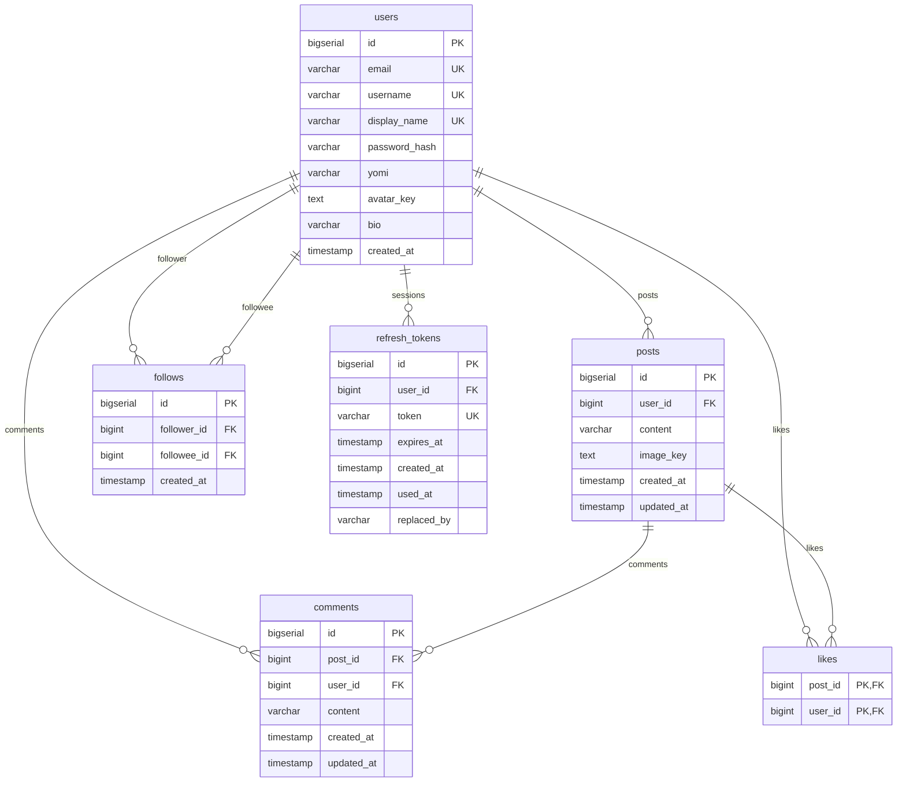

# データモデル

[← 要件定義書に戻る](../requirements.md)

`backend/src/main/resources/db/migration/V1`〜`V13` を適用した後のスキーマ。
DBの画像カラムはURLではなくobject key。APIのJSON名 `avatarUrl` / `imageUrl` とは区別する。

## ER図

## テーブル定義

| テーブル | カラム（型・制約） |
| --- | --- |
| users | id BIGSERIAL PK; email VARCHAR(256) NOT NULL UNIQUE; password_hash VARCHAR(255) NOT NULL; username VARCHAR(50) NOT NULL UNIQUE; display_name VARCHAR(50) NOT NULL UNIQUE; yomi VARCHAR(100) NULL; avatar_key TEXT NULL; bio VARCHAR(160) NULL; created_at TIMESTAMP NOT NULL DEFAULT NOW() |
| posts | id BIGSERIAL PK; user_id BIGINT NOT NULL FK; content VARCHAR(280) NOT NULL; image_key TEXT NULL; created_at・updated_at TIMESTAMP NOT NULL DEFAULT NOW() |
| comments | id BIGSERIAL PK; post_id・user_id BIGINT NOT NULL FK; content VARCHAR(280) NOT NULL; created_at・updated_at TIMESTAMP NOT NULL DEFAULT NOW() |
| likes | post_id・user_id BIGINT NOT NULL FK。2列の複合PRIMARY KEY。id・created_atカラムはない |
| follows | id BIGSERIAL PK; follower_id・followee_id BIGINT NOT NULL FK; created_at TIMESTAMP NOT NULL DEFAULT NOW(); UNIQUE(follower_id, followee_id) |
| refresh_tokens | id BIGSERIAL PK; user_id BIGINT NOT NULL FK; token VARCHAR(512) NOT NULL UNIQUE; expires_at TIMESTAMP NOT NULL; created_at TIMESTAMP NOT NULL DEFAULT NOW(); used_at TIMESTAMP NULL; replaced_by VARCHAR(512) NULL |

外部キーの削除規則はすべて `ON DELETE CASCADE`。`refresh_tokens.replaced_by` は置き換え先の
トークン文字列であり、外部キーではない。自己フォロー禁止はアプリケーション層で行う。
posts・commentsのupdated_atは自動更新トリガーではない。投稿更新時はMapperがNOW()を設定し、コメント編集APIはない。

## 索引・画像・セッション

- posts: `idx_posts_created_at`（created_at DESC）。
- comments: `idx_comments_post_id`、likes: `idx_likes_post_id`。PK・UNIQUEにもDBの索引がある。
- refresh_tokens: `idx_refresh_tokens_user_id`（再利用検知時の全セッション失効）、
  `idx_refresh_tokens_expires_at`（期限切れ削除）。
- V10でposts.image_urlをimage_keyへ変更。V11でusers.avatar_urlをavatar_keyへ変更。
  表示用URLはPresignedUrlSerializerで発行し、DBに期限付きURLを保存しない。
  未設定のアバターはUIが表示名の頭文字を表示する。
- V12でused_at・replaced_byを追加。更新時に使用済みの記録を残し、既定30秒の猶予内の再提示には
  置き換え先の未使用トークンを返す。猶予超過の再利用はユーザーの全リフレッシュトークンを失効させる。
- 期限切れレコードは既定で毎日4時に削除する。使用済みという理由だけでは削除しない。
