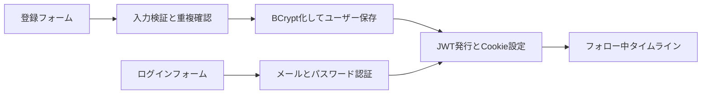

# F-01 / F-02 認証（登録・ログイン・ログアウト）

[← 要件定義書に戻る](../../requirements.md)

## 対象画面と入力

S-01 `/login`、S-02 `/register`。登録入力はemail・username・displayName・passwordと任意のyomi。
確認パスワードはUIだけで検証し、APIに送らない。登録成功後は再ログインを挟まずホームへ遷移する。

## セッションとAPI

| API | 結果 |
| --- | --- |
| POST `/api/auth/register` | 201＋AuthResponse、refreshToken Cookie |
| POST `/api/auth/login` | 200＋AuthResponse、refreshToken Cookie |
| POST `/api/auth/refresh` | Cookieからセッションを更新、200＋RefreshResponse |
| POST `/api/auth/logout` | CookieのトークンをDBから削除、Cookieを消去、204 |
| GET `/api/auth/me` | Bearer必須、200＋ログインユーザー情報 |

register/login/refresh/logoutはSecurityConfigでBearer不要。logoutでCookieがなくても204。
JWTの有効期限は既定15分、リフレッシュトークンは7日。
JWTは `frontend/src/api/auth.ts` のメモリ変数で保持する。localStorageには保存しない。
初回描画時はAuthProviderがCookieでrefreshし、未認証なら保護画面からloginへ遷移する。
通常APIの401時もrefreshを試み、成功すれば元のAPIを再試行する。

更新ではDBのトークンを使用済みにし、新しいトークンへローテーションする。
既定30秒の猶予内の再提示には置き換え先のトークンを返す。猶予超過の再利用はそのユーザーの
全リフレッシュトークンを失効させ401。期限切れトークンは定期削除する。
使用済みCookieを保存したstorageStateの長期再利用はできない。

ログアウト成功後はUIのJWT・ユーザー情報を消してloginへ遷移する。
JWT自体のサーバー側失効リストはないため、発行済みJWTを即時無効化する方式ではない。
CookieはHttpOnly・Path=/api/auth。Secure/SameSiteは現行Controllerで明示していない。

## 登録時のチェック

usernameは3〜50文字の英数字・アンダースコア、displayNameは必須50文字以内、
passwordは8〜64文字で英字と数字を含む。email・username・displayNameはそれぞれ重複不可。
yomiは任意で100文字以内。パスワードはBCryptで保存する。

入力制約と文言は [入力チェック](../input-validation.md)・[エラーメッセージ](../error-messages.md)、
データ構造は [データモデル](../data-model.md)、入出力は [API設計](../api-design.md) を参照。
