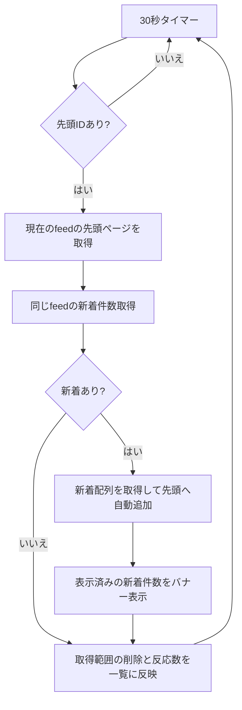

# F-04 タイムライン表示

[← 要件定義書に戻る](../../requirements.md)

## 対象と初期表示

S-03 `/`。UIの初期タブは「フォロー中」、APIのfeed省略時はall（全体）。
フォロー中は自分がフォローしているユーザーの投稿だけを表示し、自分自身の投稿は含めない。
新着順はid降順。初回・次ページは20件固定で、末尾のIntersectionObserverによって追加取得する。

| API | 内容 |
| --- | --- |
| GET `/api/posts?feed=all` | 全体の先頭20件 |
| GET `/api/posts?feed=following&cursor={id}` | フォロー先のみでid < cursorの次の20件 |
| GET `/api/posts/new-count?sinceId={id}&feed=all` | 新着件数を `{"count":N}` で返す |
| GET `/api/posts/newer?sinceId={id}&feed=following` | 指定IDより新しい投稿配列 |

feedは各APIでall/followingを指定できる。`limit` 引数は実装されていない。

## 30秒ポーリング

バナーのクリックは件数通知を消すだけで、クリックを待って新着取得する方式ではない。
空のフィード（先頭IDが0）ではポーリング処理をスキップするため、新規投稿の自動検出を保証しない。
手動のタブ切替・再読み込みで取得し直せる。WebSocket・完全な即時更新ではない。
タブ切替時は投稿配列・カーソル・新着件数をリセットし、古いfeedの初回/追加ロード結果を破棄する。

## 投稿カード

表示項目は投稿者名・avatarUrl（未設定なら表示名の頭文字）・日時・本文・imageUrl（任意）・
編集済みバッジ・いいね数と操作・コメント数と詳細リンク。本人には編集・削除ボタンがある。
いいね・コメント・フォロー中フィード・画像表示はすべて実装済み。

入力制約と文言は [入力チェック](../input-validation.md)・[エラーメッセージ](../error-messages.md)、
データ構造は [データモデル](../data-model.md)、入出力は [API設計](../api-design.md) を参照。
