# ワイヤーフレーム

[← 要件定義書に戻る](../requirements.md)

---

## S-01 ログイン画面

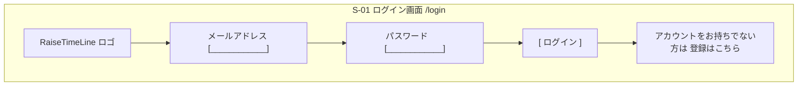

---

## S-02 ユーザー登録画面

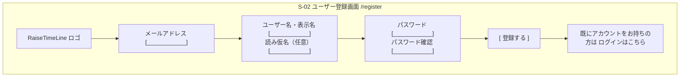

---

## S-03 タイムライン画面

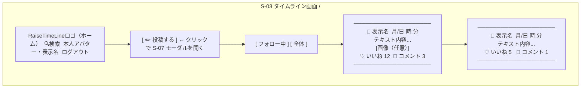

---

## S-04 投稿詳細・コメント画面

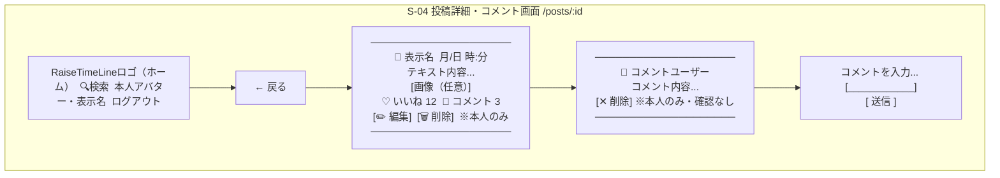

---

## S-05 プロフィール画面

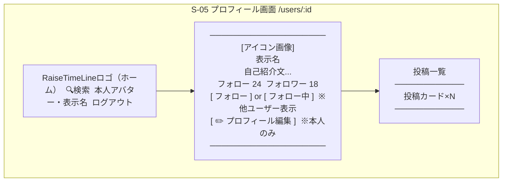

---

## S-06 ユーザー検索画面

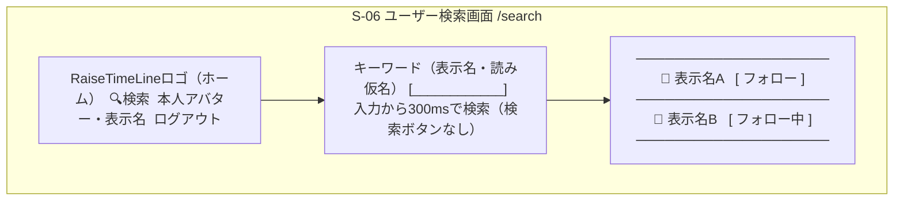

---

## S-07 投稿作成モーダル

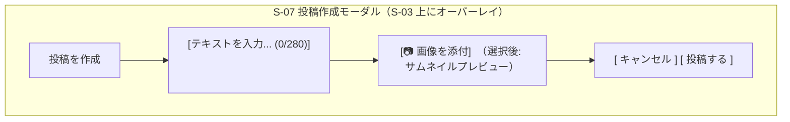

---

## S-08 投稿編集モーダル

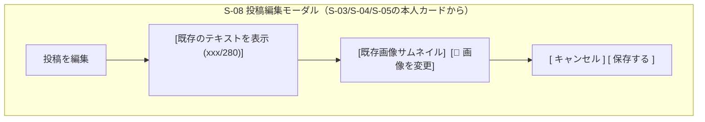

---

## S-09 フォロー/フォロワー一覧画面

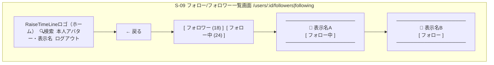

---

## S-10 プロフィール編集モーダル

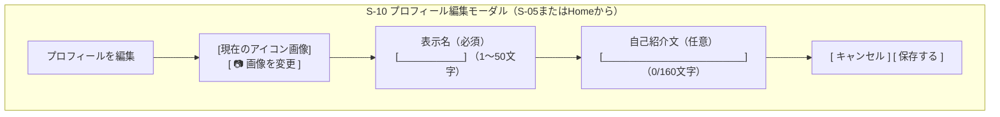

---

## D-01 削除確認ダイアログ

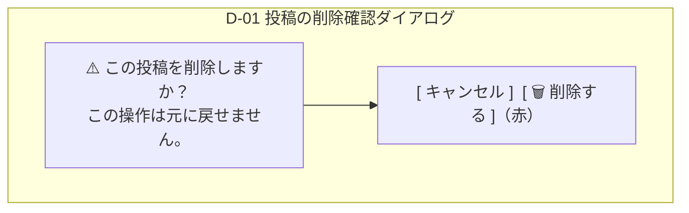

図は要素の概略で、色・余白・表示件数の数値を固定するものではない。現行React UIを基準に更新した。
prototype/は別のメモリ内デモであり、現行APIや画面の動作仕様として扱わない。
